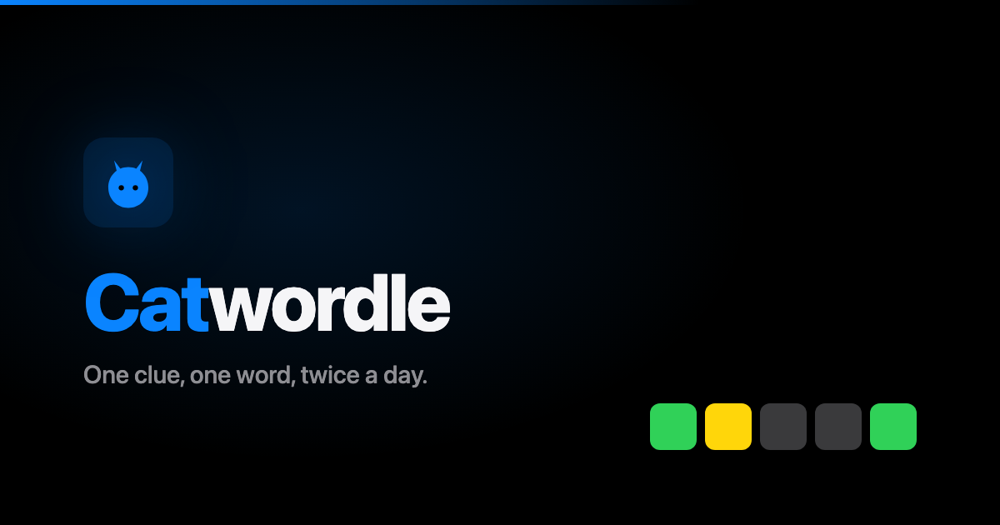

# Catwordle



A category-clued, Wordle-style word game. A new 5-letter word drops every 12
hours (one AM round, one PM round), with a category as a hint. Guess it in 6
tries, then share your result and see who else in your group has played.

**Play it at [catwordle.online](https://catwordle.online).**

## How to play

- Every 12 hours there's a new 5-letter word and a category clue.
- You get 6 guesses. Tiles turn green (right letter, right spot), yellow
  (in the word, wrong spot) or grey (not in the word).
- Pick a name to show up on the round's leaderboard. Fewest guesses wins,
  with ties broken by how fast you solved it; gold, silver and bronze
  medals add up on the all-time board.
- Stuck and already out of medal range? A one-line hint unlocks.
- Tap **Invite friends** to make a private league with its own leaderboard.

## How it's built

Single static HTML file (`src/index.template.html`) — no framework, no
bundler beyond the tiny build script described below.

**Puzzle bank:** the default word list and categories are a hardcoded array
in the page's JS (`BANK`), deterministically shuffled with a seeded PRNG so
every visitor sees the same puzzle at the same time. This is the permanent
fallback and never changes. A `round_puzzles` table (see
`supabase/002_round_puzzles.sql`) can *override* specific rounds with
auto-generated content — on boot, the page checks for a row matching the
current/previous `slot_index` and uses it if present, otherwise falls back
to `BANK`. Nothing client-side can write `round_puzzles`; a monthly
`pg_cron` job (see `word_bank` below) keeps adding fresh content, and the
game never depends on that job actually running — if it stops, the game
keeps working off whatever's already accumulated.

**Guess validation:** guesses must be real words, checked against
`src/assets/words.json` (the standard `tabatkins/wordle-list` reference
list, ~14,855 words, fetched async on boot into a `Set`). The actual
answer is always accepted regardless of dictionary membership — some
`BANK` entries are proper nouns (country/state names) not in the list,
so this safety net keeps every round winnable. If the word list hasn't
finished loading yet, validation fails open (guess is allowed) rather
than blocking play.

**Backend (Supabase/Postgres):** see `supabase/schema.sql` (core tables) and
`supabase/002_round_puzzles.sql` (puzzle overrides) for the full schema.
Tables are queried directly from the browser via Supabase's auto-generated
REST API (PostgREST) — no custom backend code:
- `devices` — per-browser name + running stats (played/wins/streak), keyed
  by a random `device_id` generated into `localStorage` on first visit.
- `device_rounds` — per-device, per-round state: in-progress/finished
  guesses, and whether the reveal banner's been dismissed. The app only
  ever reads the current (and sometimes previous) round's row, so this is
  the one table that would otherwise grow unbounded (devices × rounds,
  forever) — a `pg_cron` job (see `supabase/007_cleanup_old_device_rounds.sql`)
  purges anything older than that automatically, every 12 hours, entirely
  inside Postgres. No external scheduler, nothing to remember to run.
- `results` — the shared leaderboard, one row per (round, device). Read
  publicly through the `public_results` view, which leaves out
  `device_id`, so everyone in a round sees everyone else's result. `solve_ms` (see `supabase/005_solve_time.sql`) is each
  player's own elapsed time from their first guess to their winning
  guess, used to break ties fairly — the old behavior (breaking ties by
  absolute finish timestamp) favored whoever opened the app earliest in
  the round, not whoever actually solved it fastest once they engaged.
- `device_log` — passive browser/device info (user agent, screen size,
  language, timezone, etc.) upserted on each visit — no permission
  prompts, just standard `navigator`/`screen` properties. Each device can
  only read its own row.
- `round_puzzles` — puzzle overrides, keyed by `slot_index`. Only the
  current and past rounds are publicly readable (future rows would be
  upcoming answers), and nothing client-side can write it, since it
  controls the actual game content shown to every visitor.
- `word_bank` — a large, category-diverse pool of (category, word) pairs
  (see `supabase/008_word_bank.sql`), locked down with RLS and no public
  policies — it's never read by the client, only by the refresh job below.
  A `pg_cron` job (`refresh_round_puzzles()`) tops up the next ~30 days of
  `round_puzzles` from this pool on the 1st of every month, avoiding
  repeats where the pool allows it. Entirely inside Postgres — no external
  generation service, no API costs, nothing to remember to run. An earlier
  attempt to generate content via a scheduled Claude Code cloud routine
  hit a hard wall (its sandbox couldn't reach Supabase at all — egress
  restrictions), which is exactly the class of failure this design avoids
  by living inside the database itself, same as the `device_rounds`
  cleanup job above.

  Both `word_bank` and `round_puzzles` also carry a `hint` column (see
  `supabase/009_word_bank_hints.sql`) — a short, one-line, letter-free clue
  per word, authored once per pool entry. The frontend unlocks a hint once
  a player's guess count exceeds `max(4, this round's live bronze-place
  guess count)` — by then they're already out of medal contention, so no
  fairness penalty is needed.

- `league_members` (see `supabase/010_league_members.sql`) — private
  leaderboard groups. Joining a league (via an `?league=CODE` invite link,
  generated client-side and shared through the existing share/clipboard
  flow) just adds a `device_id`/`league_code` row; it doesn't change how
  results are recorded. A league's board is read through the
  `league_results(slot, code)` function, so you need the invite code to
  see it and the list of leagues isn't browsable.

`medal_tally` (a view, not a table — see `supabase/004_medal_tally.sql`)
computes all-time gold/silver/bronze medal counts per player live from
`results`, using the same ranking rule as the per-round badges (fewest
guesses, ties broken by solve time). No sync job or cache to keep
up to date — it just reflects whatever's in `results` at query time.

Access control is via Postgres Row Level Security (see
`supabase/011_lock_down_public_access.sql`) — the Supabase anon key is
meant to be public and is safe to ship in the built page. Each browser's
random `device_id` acts as its credential: the page sends it as an
`x-device-id` header, and RLS only lets a request read or write the
per-device rows (`devices`, `device_rounds`, `results`, `device_log`,
`league_members`) whose `device_id` matches. Public reads go through
views and functions that never return `device_id`. Names (1–16 chars)
and guess counts (1–6) are also checked in the database, not just the
browser, and the cron maintenance functions can't be called through the
API.

This replaced an earlier Google Sheets + Apps Script backend. That worked
but had a hard latency floor (~2-2.5s per Apps Script call, regardless of
how much the requests were batched) — Postgres queries are typically
50-300ms.

## Local dev

```bash
cp .env.example .env
# edit .env with your real Supabase project URL + anon key
node build.js
```

This writes `dist/index.html` with the placeholders in
`src/index.template.html` (`__CATWORDLE_SUPABASE_URL__`,
`__CATWORDLE_SUPABASE_ANON_KEY__`) substituted from your `.env`. Open
`dist/index.html` directly, or serve it with any static file server.

## Deployment

Netlify builds from this repo on every push:
- Build command: `node build.js` (see `netlify.toml`)
- Publish directory: `dist`
- `CATWORDLE_SUPABASE_URL` and `CATWORDLE_SUPABASE_ANON_KEY` are set in
  Netlify's **Site settings → Environment variables** (all deploy contexts,
  not just Production) — never in code.

Pushes to `main` deploy to production. Pull requests and other branches get
their own Deploy Preview URL automatically.

## Supabase backend setup

1. Create a project at [supabase.com](https://supabase.com).
2. **SQL Editor → New query** → paste the contents of `supabase/schema.sql`
   → Run. This creates the core tables.
3. Repeat for every numbered migration (`002_...` through `011_...`) —
   run each once, in order. `007` and `008` need the `pg_cron` extension
   (**Database → Extensions**); `011` replaces the original open policies
   with the locked-down ones described above.
4. **Project Settings → API** → copy the **Project URL** and the **`anon`
   `public`** key into `CATWORDLE_SUPABASE_URL` / `CATWORDLE_SUPABASE_ANON_KEY`.
   Never put the **`service_role`** key in `.env` or anywhere client-side —
   nothing in this app needs it.
5. No further deploy step needed — PostgREST picks up schema changes
   immediately. Future schema changes: write a new numbered `.sql`
   migration, run it in the SQL Editor.

## Privacy

No accounts, no login. `device_log` passively records standard
`navigator`/`screen` properties (user agent, screen size, language,
timezone, etc.) on each visit — no permission prompts, since none of this
requires one. It's used only for aggregate usage insight and isn't
publicly readable: each browser can only read back its own row (see
`supabase/011_lock_down_public_access.sql`). This is the whole extent of
what's collected — read `src/index.template.html`'s `collectDeviceInfo()`
for the literal list. The name you pick is shown on the public
leaderboard, so don't use anything you'd rather keep private.

## License

[MIT](LICENSE)
